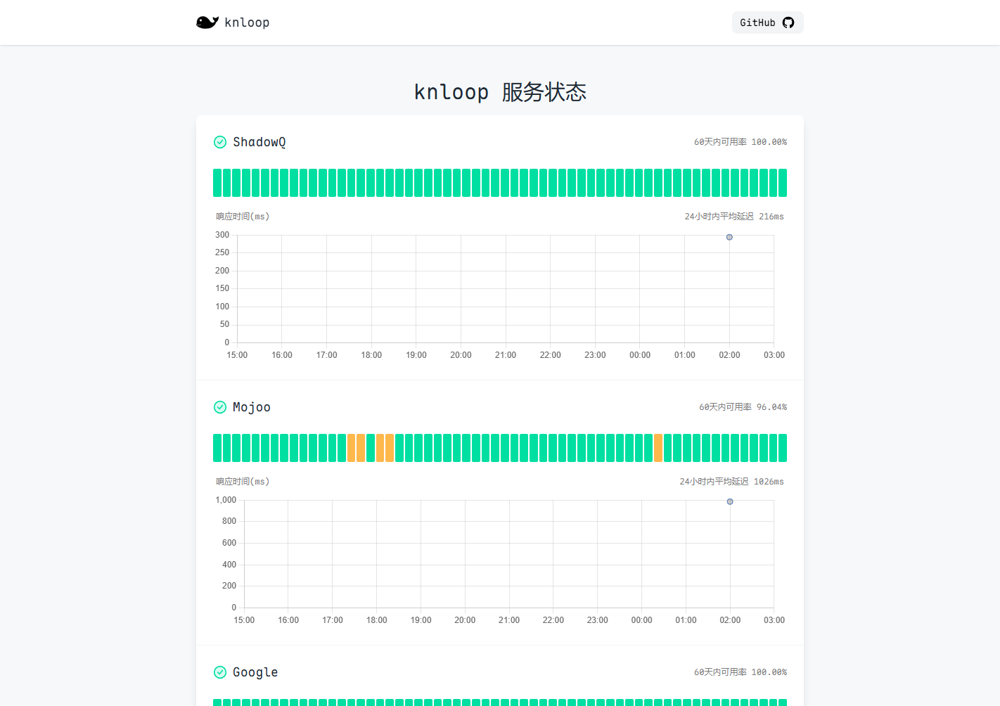

# 🆙 knloop service status

> **2026-11 新架构**：项目已重写为 **Cloudflare Workers（TypeScript）+ Hono + Svelte 5 + Tailwind CSS 4 + Chart.js + D1 + Globalping/xxapi/uapis**。
> 页面与 API 都由同一个 Worker 提供；检测由 Worker Cron（每 5 分钟）完成，不再依赖 GitHub Actions 调度。
> 新架构说明与部署：[worker/README.md](worker/README.md) ｜ [web/README.md](web/README.md) ｜ [docs/worker-api-contract.md](docs/worker-api-contract.md) ｜ [docs/kv-quota.md](docs/kv-quota.md)（存储选型/额度复盘，KV → D1）
> 下面保留的 GitHub Actions + Go 内容属于**旧版**（仍可使用），新部署请以 Worker 文档为准。
**轻量、开源、零依赖的服务状态监控。**
- 纯静态页面，无需构建工具，数据由 GitHub Actions 定时采集并提交到 `page` 分支
- GitHub Pages 发布页面；GitHub Actions 运行 Go 检测器 + 定时部署
- 检测器零第三方依赖（只用 Go 标准库），单轮每服务只写 1 行日志
- 页面只读一个聚合文件 `data/status.json`（约 20~100KB），不再拉取和重复解析原始日志
- 统计图展示中位数和 P95 数据；60 天可用率按**检查次数**计算
- 本地探测 + 重试 + 共识判定，第三方 ping API 仅作“可达性佐证”，不再污染状态和延迟
- 数据过期、请求失败会显示告警/缓存提示，不会静默展示旧数据

## 👀 查看效果

在线演示 : [status.knloop.com](https://status.knloop.com)

截图展示 :


## 🧠 检测与数据逻辑（v2）

每个服务每轮检查：
1. 本地 HTTP 探测最多 3 次（TTFB、keep-alive、浏览器 UA、跟随重定向 ≤10 跳、及时关闭 body）；
2. 成功次数 ≥ `minSuccess`（默认 2）→ `success`，延迟取成功探测的中位数；只成功 1 次 → `partial`；
3. 本地全部失败时才并发请求 xxapi.cn / uapis.cn 做可达性佐证：任一方可达 → `partial`（疑似 runner/区域网络问题），否则 `failure`；第三方延迟不参与统计；
4. 每轮每服务追加 1 行日志（`logs/<key>_report.log`）：`{"time","status","latency","ok","tries"}`；
5. 汇总生成 `data/status.json`：60 天 `daily`（状态/可用率/P50/P95/检查数/失败数）、`hourly`（整点中位数/P95）、窗口内可用率与今日故障数。

旧日志（每轮 5 行，含第三方结果）在聚合时自动兼容：只取每组前 2 行本地探测，第三方失败不再拉低可用率。

### 检测源模式（可选，默认 local，不改变现有行为）

`probe.mode` 支持三种：

- `local`（默认）：GitHub runner 本地 HTTP 探测；
- `globalping`：调用 **Globalping**（jsDelivr 公开探测网络）做多地区测量，可按国家/城市选节点（默认 CN/HK/JP/US 各 1 个）。全部地区成功=正常，部分地区成功=异常（能发现“大陆打不开、海外正常”），全部失败=故障；Globalping 免费匿名约 **250 probes/小时**，可用环境变量 `GLOBALPING_TOKEN` 提高额度；
- `hybrid`：本地探测为主，只有本地失败时才调 Globalping 做区域性佐证。

关键规则：Globalping 自身故障/限流时按 `fallbackToLocal` 降级本地探测，**不会因为第三方 API 挂掉而把服务判成故障**。默认用 HEAD（响应小）；若目标站不支持 HEAD（返回 405），把 `method` 改成 `GET`。

```jsonc
"probe": {
  "mode": "globalping",              // local | globalping | hybrid
  "globalping": {
    "type": "http",                  // http（看状态码）| ping
    "method": "HEAD",                // http 用；HEAD 响应小，GET 更接近真实访问
    "locations": [
      { "country": "CN", "limit": 1 },
      { "country": "HK", "limit": 1 },
      { "country": "JP", "limit": 1 },
      { "country": "US", "limit": 1 }
    ],
    "timeoutMs": 20000,
    "pollIntervalMs": 1000,
    "fallbackToLocal": true,
    "tokenEnv": "GLOBALPING_TOKEN"
  }
}
```

## ⚙️ 部署说明

### 方案一、GitHub Pages + GitHub Actions（推荐）

1. Fork 本项目到自己的账号。
2. 修改 `src/config.json`（服务列表 + 可选参数）：

```json
{
  "maxDays": 60,
  "maxHour": 12,
  "retentionDays": 60,
  "dataUrl": "https://raw.githubusercontent.com/<你的用户名>/<仓库名>/page/data/status.json",
  "logspath": "https://raw.githubusercontent.com/<你的用户名>/<仓库名>/page/logs",
  "pollIntervalSec": 60,
  "staleAfterMin": 45,
  "attempts": 3,
  "minSuccess": 2,
  "peerCheck": { "enabled": true, "timeoutMs": 5000 },
  "requestTimeoutMs": 5000,
  "retryDelayMs": 250,
  "userAgent": "Mozilla/5.0 (compatible; knloop-status/2.0)",
  "webhook": { "enabled": false },
  "probe": {
    "mode": "local",
    "globalping": {
      "type": "http",
      "method": "HEAD",
      "locations": [
        { "country": "CN", "limit": 1 },
        { "country": "JP", "limit": 1 },
        { "country": "US", "limit": 1 }
      ],
      "timeoutMs": 20000,
      "fallbackToLocal": true
    }
  },
  "services": [
    { "key": "ShadowQ", "url": "https://www.shadowq.com" }
  ]
}
```

3. **Settings → Pages → Build and deployment → Source 选择 “GitHub Actions”**（不要选 “Deploy from a branch”）。
4. **Settings → Actions → General → Workflow permissions 选择 “Read and write permissions”**（检测 workflow 需要 push 日志与 data）。
5. 确保两个 workflow 文件在**默认分支（一般是 `main`）**上存在：`schedule` 只会读取默认分支的 workflow；检测 job 会 checkout `page` 分支运行（所以代码和配置要同步到 `page`）。
6. 手动运行一次 `Service Status Check`，确认 `page` 分支新增提交（`logs/*.log` + `data/status.json`），再手动运行 `Deploy Status Pages`，打开站点确认数据正常。

可选：企业微信失败通知——配置 secret `WECHAT_WEBHOOK_KEY`，并把 `webhook.enabled` 设为 `true`。仅在状态发生跃迁（正常→故障、故障→恢复）时推送。

### 方案二、自建服务器本地部署

1. 安装 Go 后编译：`cd checkshell && go build -o statuscheck .`；
2. 用 cron/systemd timer 定时执行 `./statuscheck`（工作目录在 `checkshell` 下，默认读写 `../src/config.json`、`../logs`、`../data`）；
3. 纯静态页面可直接部署到任意静态服务器（nginx/apache 等）。

## 🎨 样式（Tailwind 预构建）

页面不再加载 272KB 的 Tailwind browser JIT，`public/app.css` 是预构建产物（约 17KB，已提交），页面本身零构建。修改 `index.html` 或 `src/js/*.js` 里的 class 后需要重新生成：

```bash
npm install --no-save tailwindcss@4 @tailwindcss/cli@4   # 仅首次
npx @tailwindcss/cli -i src/css/tailwind.css -o public/app.css --minify
```

源文件/设计变量在 `src/css/tailwind.css`，动态拼接的 class（如 `bg-success`、`text-failure`）已通过 `@source` 扫描 `src/js` 收录。

## 🔁 CI 行为说明

- `service-status-check.yml`：cron 每 30 分钟触发一次；每次触发后在**同一个 job 内循环约 25 分钟、每 4 分钟检查一轮**，用连续采样弥补 GitHub 定时任务的不准时；只编译一次 Go 二进制；每轮独立 commit + `pull --rebase` + 重试 push。
- `deploy-status-pages.yml`：代码 push（`index.html`/`src`/`public`/workflow 变化）+ **每 30 分钟定时** + 手动触发。定时兜底是必须的：自动化提交由 `GITHUB_TOKEN` 发出，GitHub 不会用它触发其它 workflow 的 `push` 事件。
- 已知限制：GitHub 的 `schedule` 实际触发频率可能远低于名义值（本项目实测约 7 次/天）。若需要稳定 5 分钟级实时，建议用外部 cron（如 cron-job.org / Cloudflare Cron）定时调用 `workflow_dispatch` API，或在自建服务器运行检测器。

## ❓ 常见问题

- **页面显示“数据可能延迟”**：`data/status.json` 的 `generatedAt` 超过 `staleAfterMin`。说明检测/推送/部署链路变慢或中断，先看 Actions 运行记录。
- **页面显示“数据加载失败”但有缓存**：页面会优先展示 localStorage 中的最近数据并提示刷新失败；恢复网络后会自动刷新。
- **可用率不再按天算**：现在按“成功检查次数 / 总检查次数”计算；状态块仍按天聚合（当天全部成功=正常、全部失败=故障、混合=异常）。
- **旧日志会不会丢**：不会。上传时只追加/裁剪当前窗口内记录，旧格式历史会被兼容聚合。

## 💡 灵感来自

- [kener](https://github.com/rajnandan1/kener)
- [statuspage](https://github.com/statsig-io/statuspage/)
- [UptimeFlare](https://github.com/lyc8503/UptimeFlare)
- [statusfy](https://github.com/juliorodriguez/statusfy)
- [uptime-status](https://github.com/yb/uptime-status)
